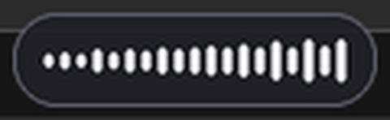

# LocalDictation（本地听写）

**免费、完全离线的 Windows 按住说话工具。** 按住快捷键说话，松开，文字直接打进光标所在输入框。不连云、不卡顿、零订阅。



## 我为什么要做这个

我曾经是某知名云端听写工具（Wispr Flow，$20/月）的付费用户。三个痛点让我弃用：

1. **卡顿**：语音要传到远程服务器再传回来，网络一抖文字就卡住；
2. **隐私**：你说的一切都会上传到别人的云端；
3. **成本**：每月 20 美元，无限期。

LocalDictation 把三个痛点全部解决：

| | 云端听写 | **LocalDictation** |
|---|---|---|
| 延迟 | 看网络脸色 | **解码约 0.1 秒，纯 CPU** |
| 语音数据 | 上传云端 | **从不离开你的电脑** |
| 费用 | $20/月 | **$0** |
| 磁盘占用 | — | **约 320MB**（模型+运行时） |

## 功能

- **按住说话**：`Ctrl+Space` 按住录音、松开出字（物理按键轮询触发，按下顺序/输入法干扰都不漏触发）
- **Wispr 式声波胶囊**：小圆角浮窗贴在你正在工作的那块屏的任务栏上方，跨屏跟随，不抢焦点
- **中文优先的高准确率**：SenseVoice Small，36 条测试集整体字错率 **0.75%**（纯中文/数字/长句 0%）
- **可编辑的专有名词替换表**（`replacements.json`）：识别歪的术语自己改（如 "get up" → `GitHub`），每次听写自动热重载
- 托盘图标可暂停/退出；可设开机自启
- 英/日/韩/粤语也能识别（自动检测语言）

## 安装（Windows 10/11）

```bat
git clone https://github.com/dillanhill490/71-OpenSource-LocalDictation-2026-11-8.git
cd 71-OpenSource-LocalDictation-2026-11-8
pip install -r requirements.txt
python download_model.py      :: 约 155MB，一次性
python dictation.py
```

开机自启：给 `pythonw.exe dictation.py` 建一个快捷方式放进启动文件夹（`Win+R` → `shell:startup`）。

## 配置

- **专有名词**：编辑脚本旁边的 `replacements.json`，格式 `"识别错的样子": "正确写法"`。拉丁词按整词忽略大小写匹配；中文按原文替换。每次听写自动重载。
- **托盘菜单**：暂停（释放 Ctrl+Space）/ 退出。

## 实现原理

- 识别：[SenseVoice Small](https://github.com/FunAudioLLM/SenseVoice) int8 ONNX，经 [sherpa-onnx](https://github.com/k2-fsa/sherpa-onnx) 推理——非自回归 CTC，笔记本 CPU（无 GPU）10 秒语音约 100ms 解码
- 热键：15ms 轮询物理按键状态（`GetAsyncKeyState`）——按下顺序、丢事件、输入法吞键都不会漏
- 打字：`SendInput` Unicode 注入当前焦点窗口
- 浮窗：Win32 分层窗口（`UpdateLayeredWindow`，逐像素透明），**每次录音会话都用全新窗口**——休眠/唤醒/切屏后不会出现陈旧失效

## Roadmap

- [ ] macOS 适配（打字注入、热键、浮窗需原生重写——欢迎 PR）
- [ ] 管理员/沙箱窗口的剪贴板粘贴兜底
- [ ] 中文开发者热词包持续扩充

## 致谢与许可

- **SenseVoice Small** 模型 © Alibaba FunAudioLLM——权重遵循 [FunASR 模型开源协议](https://github.com/modelscope/FunASR/blob/main/MODEL_LICENSE)，源代码 MIT。本仓库不重分发模型，`download_model.py` 从官方源拉取
- **sherpa-onnx** — Apache-2.0
- 本项目 — [MIT](LICENSE)

本项目与 Alibaba、k2-fsa、Wispr (Flow) 均无隶属关系。

## 实测基准

36 条合成语音（纯中文/数字日期/中英混说/技术词/长句 × 2 音色），每条 3 次取中位：

| 类别 | 字错率 |
|---|---|
| 纯中文 | 0% |
| 数字日期 | 0% |
| 长句 | 0% |
| 中英混说 | 1.51% |
| 技术词 | 2.94% |
| **整体** | **0.75%** |

（少数错误来自测试集 TTS 念英文词的口音，真人语音表现更好；误识别的术语用 `replacements.json` 兜底。）
